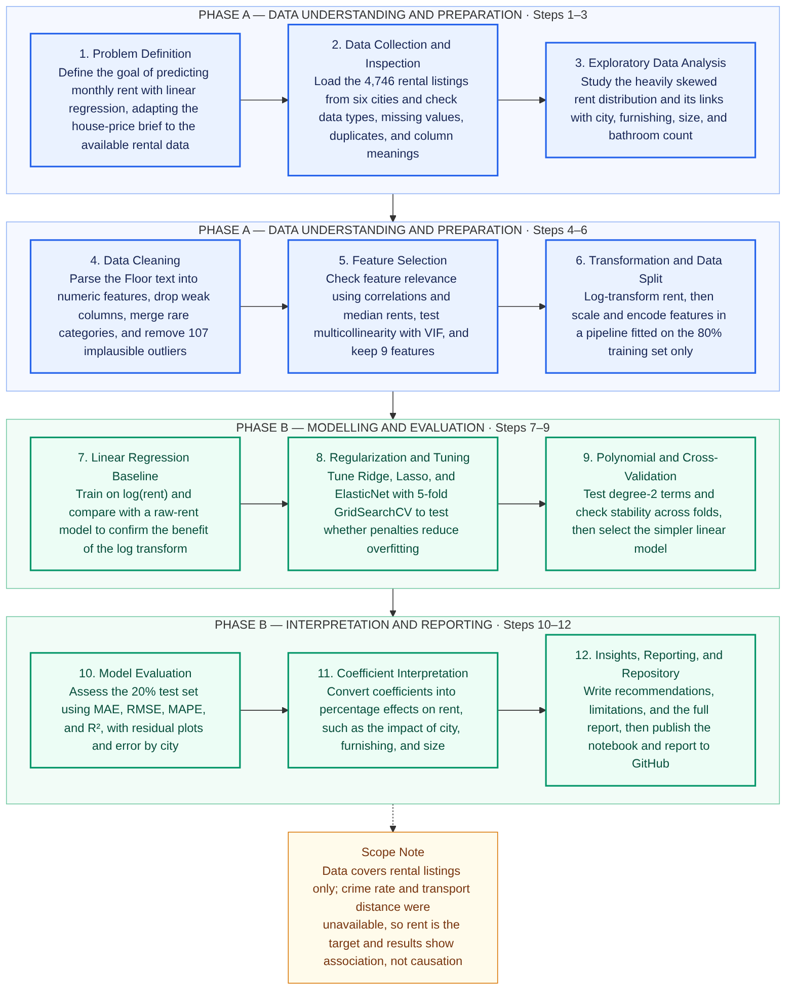

# House Rent Prediction

Predicting monthly rent for 4,700+ listings across six Indian cities using linear regression on log(rent).
## Project summary
This project builds a linear regression model that predicts monthly rent from property features (city, size, BHK, bathrooms, floor, furnishing, area type and tenant preference). The workflow covers data exploration, preprocessing, feature selection and transformation, model building (Linear, Ridge, Lasso, ElasticNet and Polynomial regression), evaluation and recommendations.

**Main result:** On a held-out test set the final linear model reaches R² ≈ 0.70 (about 0.83 on the log scale) with an average error of about 32%.

## Repository structure
```
├── notebooks/   Google Colab notebook (code and explanations)
├── data/        House_Rent_Dataset.csv
├── report/      Project report (PDF)
├── diagrams/    Project workflow diagram (image and Mermaid source)
└── requirements.txt
```
## Project workflow


## How to run Update README.md
1. Open the notebook in Colab:
   [Open in Colab](https://colab.research.google.com/github/Foundnationz/house-rent-prediction/blob/main/notebooks/Rent_Prediction_Colab.ipynb)
2. Upload `House_Rent_Dataset.csv` (from the `data` folder) to your Google Drive and update the file path in the "Load and Inspect the Dataset" cell.
3. Run all cells from top to bottom.

## Notes
- The dataset contains rental listings, so the target variable is monthly rent. Currency (INR) and size unit (square feet) are assumed because the file does not state them.
- Dataset source: https://www.kaggle.com/datasets/iamsouravbanerjee/house-rent-prediction-dataset?select=House_Rent_Dataset.csv
